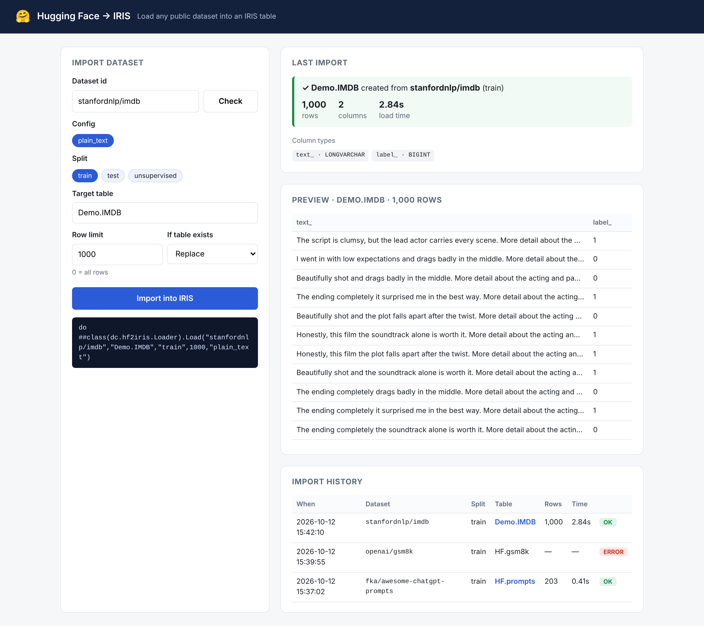
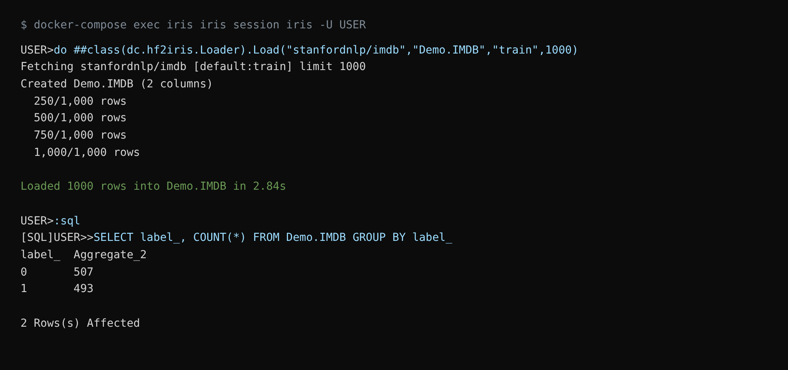

# iris-hf-loader

Load any public [Hugging Face](https://huggingface.co/datasets) dataset into an InterSystems IRIS table — with **one line of ObjectScript** or **one click** in a small web UI.

Built for the InterSystems Community Bounty Program, Round 3: *Load Datasets from Hugging Face into IRIS* ([DPI-I-543](https://ideas.intersystems.com/ideas/DPI-I-543)).



## Features

- One-line import: `do ##class(dc.hf2iris.Loader).Load("stanfordnlp/imdb","Demo.IMDB",,1000)`
- Web UI at `/hf2iris/` — check a dataset's configs and splits, import, preview rows, see history
- Automatic table creation with type mapping (integers, floats, booleans, timestamps, text)
- Nested fields (lists, dicts, embeddings) are stored as JSON in `LONGVARCHAR` columns
- Column names cleaned for SQL: spaces and symbols become `_`, and reserved words get a trailing underscore (`text` → `text_`, `label` → `label_`, `id` → `id_`, `type` → `type_`)
- Legacy dataset ids without a namespace (e.g. `rotten_tomatoes`) are resolved to their canonical `owner/name` id on the Hub
- Row limit for large datasets, and `replace` / `append` / `fail` modes
- Every run is logged in `dc_hf2iris.ImportLog`
- REST API for automation
- Works from Python too: `import hf2iris; hf2iris.load("stanfordnlp/imdb", "Demo.IMDB", limit=1000)`

## Installation

### Docker (recommended)

```bash
git clone https://github.com/<your-account>/iris-hf-loader.git
cd iris-hf-loader
docker-compose up -d --build
```

Open <http://localhost:52773/hf2iris/index.html>. The REST API uses `_SYSTEM` / `SYS` (basic auth) — see [Known issues](#known-issues) about logging in from the browser.

On the very first start the container may restart once: the post-start script of the current `intersystemsdc/iris-community` image fails (`dbapi.connect`), and `restart: always` brings it back up already initialized.

### IPM

```objectscript
zpm "install iris-hf-loader"
```

Requires IRIS 2023.1+ with embedded Python. IPM installs the Python requirements (`datasets`, `pandas`, `pyarrow`).

## Usage

### ObjectScript

```objectscript
// simplest form: whole train split into HF.imdb
do ##class(dc.hf2iris.Loader).Load("stanfordnlp/imdb")

// first 1000 rows into Demo.IMDB
do ##class(dc.hf2iris.Loader).Load("stanfordnlp/imdb","Demo.IMDB","train",1000)

// dataset with several configs, append to an existing table
do ##class(dc.hf2iris.Loader).Load("openai/gsm8k","Demo.GSM8K","test",0,"main","append")

// see configs and splits before loading
write ##class(dc.hf2iris.Loader).Info("openai/gsm8k").%ToJSON()
```

Arguments of `Load`:

| Argument | Default | Meaning |
|---|---|---|
| `dataset` | — | Hugging Face id, e.g. `stanfordnlp/imdb` |
| `table` | `HF.<name>` | Target table `Schema.Table` |
| `split` | `train` | Split to load |
| `limit` | `0` | Max rows, `0` = all |
| `config` | `""` | Config/subset name, when the dataset has several |
| `mode` | `replace` | `replace`, `append` or `fail` if the table exists |



### SQL

```sql
SELECT label_, COUNT(*) FROM Demo.IMDB GROUP BY label_
```

### REST API

Base path `/api/hf2iris` (password authentication).

| Method | Path | Body / params |
|---|---|---|
| GET | `/info?dataset=stanfordnlp/imdb` | configs and splits |
| POST | `/load` | `{"dataset":"stanfordnlp/imdb","table":"Demo.IMDB","split":"train","limit":1000}` |
| GET | `/history` | last 50 imports |
| GET | `/preview/Demo.IMDB?rows=20` | first rows and total count (only tables created by this tool) |

## How it works

1. `dc.hf2iris.Loader` calls the Python package `hf2iris` through embedded Python.
2. `hf2iris` uses the Hugging Face `datasets` library to download the split (with the row limit applied server-side by `split="train[:1000]"`) and turns it into a pandas DataFrame.
3. Each column is mapped to an IRIS SQL type (string length is measured over the whole column, not a sample) and a `CREATE TABLE` is run.
4. Rows are inserted in batches with a prepared `INSERT` statement via `iris.sql`.
5. The result is logged to `dc_hf2iris.ImportLog`.

| pandas / dataset type | IRIS type |
|---|---|
| int | `BIGINT` |
| float | `DOUBLE` |
| bool | `BIT` |
| datetime | `TIMESTAMP` |
| string, longest value ≤ 2000 chars | `VARCHAR(4000)` |
| longer string, list, dict, array | `LONGVARCHAR` (lists/dicts/arrays as JSON) |

## Project layout

```
python/hf2iris/       Python package (download, type mapping, insert)
src/dc/hf2iris/       Loader.cls, ImportLog.cls, REST.cls
web/index.html        Web UI
tests/                Python unit tests (run with pytest)
module.xml            IPM package
Dockerfile, docker-compose.yml, iris.script
```

## Tests

```bash
pip install pandas pytest
pytest tests
```

The tests run the loader logic against SQLite so they need neither IRIS nor network access.

## Notes

- Gated datasets need a Hugging Face token: set `HF_TOKEN` in the container environment.
- Large datasets: use the row limit first. The `datasets` library caches downloads in `HF_HOME`.
- After changing the Python package, run `zpm "load /home/irisowner/dev/ -v"` **and** restart the container (`docker-compose restart`): web server processes keep the old `hf2iris` module in memory, so the REST API keeps running the old code until then.

## Known issues

- **Browser login for the web UI.** The page loads, but its API calls are sent without credentials, and `/api/hf2iris` answers 401 without a `WWW-Authenticate` header, so the browser never shows a login prompt. Cause: before login, IRIS runs `%CSP.REST.Login` with no roles, which cannot read `dc.hf2iris.REST` from the USER database (`<PROTECT>` in `^ISCLOG`). The REST API works with basic auth, e.g. `curl -u _SYSTEM:SYS http://localhost:52773/api/hf2iris/history`.

## License

MIT
